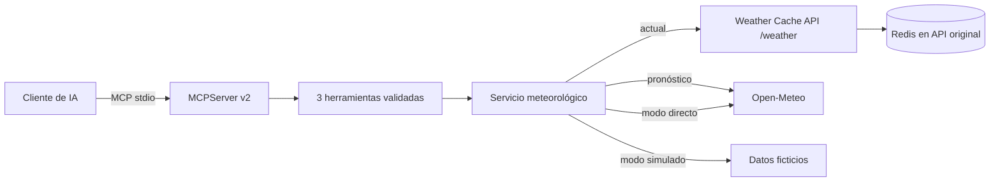

# Weather MCP Server

[](https://github.com/RamonRDR/weather-mcp-server/actions/workflows/ci.yml)

**Python 3.14 · SDK oficial de MCP v2 · Pydantic v2 · httpx · Open-Meteo**

Servidor real de **Model Context Protocol (MCP)** con tres herramientas meteorológicas de solo lectura para asistentes de IA. Usa transporte stdio, publica esquemas tipados de entrada y salida y responde a llamadas MCP. No es una API REST renombrada.

[English](README.md) · [Português](README.pt-BR.md) · [Arquitectura](docs/architecture.md) · [Demostración](docs/demo.md)

## ¿Qué es MCP?

MCP estandariza cómo los clientes de IA descubren e invocan herramientas. El cliente inicia este servidor como proceso local, negocia el protocolo, descubre las herramientas y recibe resultados estructurados. No requiere un modelo real ni una suscripción de IA.

## Herramientas

| Herramienta | Entrada | Resultado |
| --- | --- | --- |
| `get_current_weather` | `city` (1–100 caracteres) | ubicación, fecha de observación, temperatura, sensación térmica, humedad, precipitación, viento, condición y fuente |
| `get_weather_forecast` | `city`, `days` (1–7; predeterminado 3) | fechas, temperaturas mínimas/máximas, probabilidad de lluvia, condiciones y fuente |
| `compare_weather` | `first_city`, `second_city` | dos lecturas actuales y diferencia de temperatura (primera menos segunda) |

Los valores opcionales desconocidos son `null`, nunca inventados. Las temperaturas están en °C y el viento en km/h. No se admiten operaciones de escritura, comandos del sistema, acceso a archivos o URL arbitrarias.

## Arquitectura



La [Weather Cache API](https://github.com/RamonRDR/weather-cache-api) implementa `GET /weather?city=` y `GET /metrics` en la rama `feat/cycle-1-weather-cache`, todavía sin fusionar con main. **No existe un endpoint de pronóstico**. Este MCP reutiliza su contrato actual y deja el caché Redis en el otro repositorio; los pronósticos provienen directamente de Open-Meteo.

## Instalación

Se recomienda **Python 3.14** y un entorno virtual:

```bash
python -m venv .venv
# Active el entorno virtual para su sistema.
python -m pip install -e '.[dev]'
cp .env.example .env
```

En PowerShell: `Copy-Item .env.example .env` y `.venv\Scripts\Activate.ps1`.

## Configuración

| Variable | Valor inicial | Uso |
| --- | --- | --- |
| `MCP_BACKEND` | `cache_api` | `cache_api`, `open_meteo` o `mock` |
| `MCP_CACHE_API_BASE_URL` | `http://127.0.0.1:8000` | origen de la API; HTTPS obligatorio para destinos remotos |
| `MCP_HTTP_TIMEOUT_SECONDS` | `5` | timeout HTTP positivo, hasta 30 segundos |
| `MCP_RATE_LIMIT_CALLS` | `60` | cuota de llamadas por proceso |
| `MCP_RATE_LIMIT_WINDOW_SECONDS` | `60` | duración de ventana |
| `MCP_LOG_LEVEL` | `INFO` | registros JSON en stderr |

El backend inicial `cache_api` requiere que la API original esté activa para condiciones actuales. Si no está disponible, seleccione `MCP_BACKEND=open_meteo` para consultas reales directas, sin Redis. `MCP_BACKEND=mock` devuelve **datos ficticios fijos** para pruebas.

## Ejecución

```bash
python -m weather_mcp_server
# o:
weather-mcp-server
```

El servidor espera mensajes MCP del cliente, sin pedir prompts de texto común. stdout se reserva para el protocolo; los registros operativos utilizan stderr.

### Ejemplo de configuración de cliente

Cada aplicación host tiene su propio formato; este JSON es ilustrativo:

```json
{
  "mcpServers": {
    "weather": {
      "command": "python",
      "args": ["-m", "weather_mcp_server"],
      "env": {"MCP_BACKEND": "mock"}
    }
  }
}
```

El comando Python debe usar el entorno donde está instalado el paquete. Cambie `mock` por `open_meteo` para datos reales o por `cache_api` con la API externa ejecutándose.

### MCP Inspector

Con Node.js/`npx` disponible:

```bash
MCP_BACKEND=mock npx @modelcontextprotocol/inspector python -m weather_mcp_server
```

En PowerShell: `$env:MCP_BACKEND='mock'; npx @modelcontextprotocol/inspector python -m weather_mcp_server`. Explore las herramientas, ejecute consultas y compruebe las respuestas estructuradas y los errores de entrada. Consulte [demo](docs/demo.md).

## Ejemplo estructurado

**Datos ficticios**, no una observación real:

```json
{
  "location": {"name": "Berlin", "country": "Germany", "latitude": 52.52, "longitude": 13.41},
  "observed_at": "2026-10-01T12:00:00Z",
  "temperature_c": 18.0,
  "apparent_temperature_c": null,
  "relative_humidity_percent": null,
  "precipitation_mm": null,
  "wind_speed_kmh": null,
  "weather_code": 0,
  "condition": "Clear sky (fictional sample)",
  "source": "mock-fixture",
  "cached": null
}
```

El pronóstico incluye fechas y rangos de temperatura; la comparación contiene las dos lecturas y su diferencia. Los argumentos inválidos generan errores MCP (`is_error=true`).

## Pruebas y GitHub Actions

```bash
ruff check .
ruff format --check .
python -m pytest -q
python -m build
python -m weather_mcp_server.demo
```

GitHub Actions usa un runner estándar de GitHub con Python 3.14 para Ruff, pruebas unitarias con HTTP simulado, integración MCP en memoria y con stdio real, y creación del paquete. Las pruebas obligatorias no necesitan Redis, API meteorológica externa, credenciales ni modelos de IA de pago. No se realiza despliegue ni fusión automática.

## Seguridad y limitaciones

Validación de ciudad y máximo de siete días, destinos externos fijados en configuración y código, HTTPS para hosts remotos, sin redirecciones, timeouts y errores públicos que no exponen secretos. Los registros van a stderr. La cuota de llamadas es por proceso, no autenticación distribuida. Una ciudad ambigua puede resolverse como la primera coincidencia.

La Weather Cache API necesita ejecutarse aparte desde su rama de desarrollo y todavía no ofrece pronósticos. Consultas reales requieren red; respete los términos de Open-Meteo. No se incluye transporte HTTP remoto porque requiere autenticación, controles de origen y sesiones. Más detalles: [arquitectura](docs/architecture.md), [demostración](docs/demo.md).

## Licencia

Datos meteorológicos: [Open-Meteo](https://open-meteo.com/). Código bajo [licencia MIT](LICENSE). © 2026 Ramon Rodriguez.
