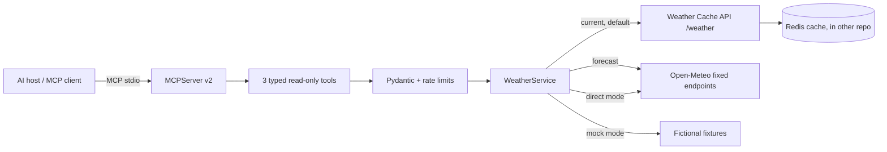

# Weather MCP Server

[](https://github.com/RamonRDR/weather-mcp-server/actions/workflows/ci.yml)

**Python 3.14 · Official MCP SDK v2 · Pydantic v2 · httpx · Open-Meteo**

A genuine, read-only **Model Context Protocol (MCP)** server that provides structured weather tools to AI assistants. It speaks MCP over standard input/output, advertises machine-readable input and output schemas and handles tool calls from compatible clients. It is **not** a REST API with a new name.

[Português](README.pt-BR.md) · [Español](README.es.md) · [Architecture](docs/architecture.md) · [Demonstration](docs/demo.md)

## Why MCP?

MCP standardizes the way AI hosts discover and call tools. A host launches this server as a child process, negotiates the protocol, discovers tools and consumes typed results. No LLM, model subscription or cloud AI provider is required for this server.

## Available tools

| Tool | Input | Structured response |
| --- | --- | --- |
| `get_current_weather` | `city` (1–100 characters) | location, observation timestamp, temperature, apparent temperature, humidity, precipitation, wind, WMO condition and provider |
| `get_weather_forecast` | `city`, `days` (1–7; default 3) | location, daily dates, min/max temperature, precipitation probability and condition |
| `compare_weather` | `first_city`, `second_city` | two current reports and temperature difference (first minus second) |

Missing optional values are `null`, never estimates. Temperatures are °C and winds are km/h. All tools are read-only; no shell execution, arbitrary URLs, filesystem access, data modification or credential exposure.

## Architecture



**Integration contract:** [Weather Cache API](https://github.com/RamonRDR/weather-cache-api) currently provides `GET /weather?city=` in its *unmerged feature branch*, plus `GET /metrics`. The MCP server uses the current-weather endpoint and its existing cache metadata; it does not invent or call a forecast endpoint. Forecasts use Open-Meteo directly. There is no duplicated caching logic.

## Requirements and installation

Python **3.14** and a virtual environment are recommended. Python packaging and the SDK's dependencies are installed from PyPI.

```bash
python -m venv .venv
# Activate .venv using the command for your OS.
python -m pip install -e '.[dev]'
cp .env.example .env   # Or configure environment variables in your MCP host
```

On Windows PowerShell use `Copy-Item .env.example .env` and `.venv\Scripts\Activate.ps1`.

## Configuration

| Variable | Default | Meaning |
| --- | --- | --- |
| `MCP_BACKEND` | `cache_api` | `cache_api`, `open_meteo`, or `mock` |
| `MCP_CACHE_API_BASE_URL` | `http://127.0.0.1:8000` | Existing API origin; HTTPS required for remote hosts |
| `MCP_HTTP_TIMEOUT_SECONDS` | `5` | HTTP timeout (0–30 seconds, positive) |
| `MCP_RATE_LIMIT_CALLS` | `60` | Per-process tool-call quota |
| `MCP_RATE_LIMIT_WINDOW_SECONDS` | `60` | Quota window in seconds |
| `MCP_LOG_LEVEL` | `INFO` | JSON logs on stderr |

The **default mode requires** a running [Weather Cache API](https://github.com/RamonRDR/weather-cache-api) when calling current-weather tools. To run standalone with real Open-Meteo network requests, set `MCP_BACKEND=open_meteo`. For fully offline tests or demonstrations, set `MCP_BACKEND=mock`; its weather is **fictional, not live**.

## Run the stdio server

```bash
python -m weather_mcp_server
# Or, after installation:
weather-mcp-server
```

It waits silently for an MCP client. Do not type natural-language prompts directly in its stdin. stdout is reserved for JSON-RPC messages, with operational logs written to stderr.

### MCP client configuration

Configure your host with a *local executable and arguments*, adjusting Python path or venv path. This is an illustrative client configuration, **not** a universal host format:

```json
{
  "mcpServers": {
    "weather": {
      "command": "python",
      "args": ["-m", "weather_mcp_server"],
      "env": {"MCP_BACKEND": "mock"}
    }
  }
}
```

Replace `mock` with `open_meteo` for direct real-provider queries, or `cache_api` if its companion REST service is running. The Python command must resolve to the environment where this package is installed. Consult your host's documentation for the exact client settings format.

### MCP Inspector

From the activated environment, with Node.js and `npx` installed:

```bash
MCP_BACKEND=mock npx @modelcontextprotocol/inspector python -m weather_mcp_server
```

PowerShell: `$env:MCP_BACKEND='mock'; npx @modelcontextprotocol/inspector python -m weather_mcp_server`. Discover the tools and call them interactively. [Demo instructions](docs/demo.md).

## Example structured result

**Fictional fixture** (not observed live weather):

```json
{
  "location": {"name": "Berlin", "country": "Germany", "latitude": 52.52, "longitude": 13.41},
  "observed_at": "2026-10-01T12:00:00Z",
  "temperature_c": 18.0,
  "apparent_temperature_c": null,
  "relative_humidity_percent": null,
  "precipitation_mm": null,
  "wind_speed_kmh": null,
  "weather_code": 0,
  "condition": "Clear sky (fictional sample)",
  "source": "mock-fixture",
  "cached": null
}
```

The forecast returns an array of dated entries, and comparisons return two reports plus `temperature_difference_c`. Invalid arguments and unavailable upstreams return MCP tool errors (`is_error=true`), not fake successful readings.

## Testing and CI

```bash
ruff check .
ruff format --check .
python -m pytest -q
python -m build
python -m weather_mcp_server.demo
```

GitHub Actions runs on a standard GitHub-hosted **Python 3.14** runner for PRs and relevant main pushes. It verifies Ruff, unit/mocked HTTP tests, in-process MCP discovery/call tests, **real stdio subprocess integration**, and package build. Required tests do not need Redis, Open-Meteo uptime, AI calls or credentials. No self-hosted runner, automatic deploy or automatic merge is configured.

## Security and known limitations

- The local stdio process is read-only and fixed-destination; it does not accept URLs from a model.
- City input and 1–7 forecast days are validated; excessive requests, timeouts, incomplete responses and errors are handled with redacted public messages.
- Logging goes to **stderr** and omits secrets and raw provider payloads. The process quota is not distributed and is not equivalent to authenticated remote rate limiting.
- Location matching uses the provider's first geocoding result, so ambiguous city names may refer to an unintended location.
- The initial Weather Cache API has current weather only and lives on an open PR branch. It must be started separately; it is not automatically installed or deployed here.
- Internet access is required for real upstream calls. Open-Meteo reliability and licensing/attribution terms remain third-party concerns.
- Remote HTTP MCP transport is **not included**; exposing this server publicly requires a separate security design.

See [technical decisions](docs/architecture.md) and [demo/proof instructions](docs/demo.md).

## Credits and license

Weather data: [Open-Meteo](https://open-meteo.com/) and the companion [Weather Cache API](https://github.com/RamonRDR/weather-cache-api). Review Open-Meteo terms before commercial use.

Licensed under [MIT](LICENSE). Copyright © 2026 Ramon Rodriguez.
