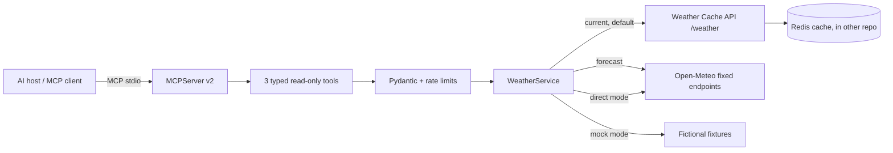

<div align="center">

# Weather MCP Server 🌦️

**Weather tools for AI assistants, powered by real MCP.**

[🇺🇸 English](README.md) · [🇧🇷 Português](README.pt-BR.md) · [🇪🇸 Español](README.es.md)

[](https://github.com/RamonRDR/weather-mcp-server/actions/workflows/ci.yml)
[](https://www.python.org/)
[](LICENSE)


[](https://github.com/RamonRDR/weather-cache-api)


</div>

> **Project status:** Implemented in [PR #1](https://github.com/RamonRDR/weather-mcp-server/pull/1), awaiting final Codex review and maintainer merge approval. The [latest pre-maintenance quality run](https://github.com/RamonRDR/weather-mcp-server/actions/runs/42416169603) passed with **32 tests, 0 failures and 0 skips**. No remote MCP deployment or live end-to-end provider validation is claimed.

A read-only **Model Context Protocol (MCP)** server with structured tools for current conditions, daily forecasts and cross-city comparisons. It uses the official MCP Python SDK and stdio, not a REST API disguised as MCP. Tool inputs and outputs are validated with Pydantic.

## Why MCP?

MCP standardizes the way AI hosts discover and call tools. A host launches this server as a child process, negotiates the protocol, discovers tools and consumes typed results. No LLM, model subscription or cloud AI provider is required for this server.

## Features

| Tool | Input | Structured response |
| --- | --- | --- |
| `get_current_weather` | `city` (1–100 characters) | location, observation timestamp, temperature, apparent temperature, humidity, precipitation, wind, WMO condition and provider |
| `get_weather_forecast` | `city`, `days` (1–7; default 3) | location, daily dates, min/max temperature, precipitation probability and condition |
| `compare_weather` | `first_city`, `second_city` | two current reports and temperature difference (first minus second) |

Missing optional values are `null`, never estimates. Temperatures are °C and winds are km/h. All tools are read-only; no shell execution, arbitrary URLs, filesystem access, data modification or credential exposure.

## Technology stack

**Runtime:** Python **3.14** in GitHub Actions, official MCP Python SDK **>=2.3,<3** (stdio), Pydantic **v2** (`>=2.10,<3`), Pydantic Settings (`>=2.7,<3`) and httpx (`>=0.28,<1`). Version badges with a plus sign indicate **declared minimums**, not a pinned dependency resolution.

**Tool integrations:** Three typed read-only MCP tools with discovery and structured responses. The [Weather Cache API](https://github.com/RamonRDR/weather-cache-api) adapter handles current conditions using its existing `GET /weather?city=` contract; Open-Meteo's fixed geocoding/forecast endpoints handle daily forecasts and optional direct current-weather mode. The adapters are **implemented and tested with mocked HTTP**; no live joint-service run is claimed. The separate Cache API owns Redis; **this repository has no database or Docker Compose**.

**Engineering:** pytest (including parametrized cases), pytest-asyncio, Ruff lint and formatter, stdio protocol integration tests, GitHub Actions, setuptools build backend, and `python -m build` producing wheel and source distribution. The CI verifies wheel installation; it does not run mypy, a Docker build, OpenAPI/Swagger, or a coverage measurement.

## Project structure

| Path | Responsibility |
| --- | --- |
| `src/weather_mcp_server/server.py` | MCP server, three typed tools and public error boundary |
| `src/weather_mcp_server/__main__.py` | Local stdio entry point |
| `src/weather_mcp_server/service.py` | Weather Cache API and Open-Meteo HTTP adapters |
| `src/weather_mcp_server/schemas.py` | Pydantic input/output and provider contracts |
| `src/weather_mcp_server/config.py` | Environment settings and outbound URL restrictions |
| `src/weather_mcp_server/rate_limit.py` | Per-process tool-call quota |
| `src/weather_mcp_server/demo.py`, `demo_data.py` | Offline MCP demo with explicitly fictional data |
| `tests/test_mcp.py`, `tests/test_service.py` | Protocol and mocked HTTP tests |
| `scripts/check_readme_badges.py` | Compare badge counts with pytest JUnit results |
| `.github/workflows/ci.yml` | Ruff, tests, badge consistency and package validation |

## Architecture



**Integration contract:** [Weather Cache API](https://github.com/RamonRDR/weather-cache-api) currently provides `GET /weather?city=` in its current **main** branch, plus `GET /metrics`. The MCP server uses the current-weather endpoint and its existing cache metadata; it does not invent or call a forecast endpoint. Forecasts use Open-Meteo directly. There is no duplicated caching logic.

## Requirements and installation

Python **3.14** and a virtual environment are recommended. Python packaging and the SDK's dependencies are installed from PyPI.

```bash
python -m venv .venv
# Activate .venv using the command for your OS.
python -m pip install -e '.[dev]'
cp .env.example .env   # Or configure environment variables in your MCP host
```

On Windows PowerShell use `Copy-Item .env.example .env` and `.venv\Scripts\Activate.ps1`.

## Configuration

| Variable | Default | Meaning |
| --- | --- | --- |
| `MCP_BACKEND` | `cache_api` | `cache_api`, `open_meteo`, or `mock` |
| `MCP_CACHE_API_BASE_URL` | `http://127.0.0.1:8000` | Existing API origin; HTTPS required for remote hosts |
| `MCP_HTTP_TIMEOUT_SECONDS` | `5` | HTTP timeout (0–30 seconds, positive) |
| `MCP_RATE_LIMIT_CALLS` | `60` | Per-process tool-call quota |
| `MCP_RATE_LIMIT_WINDOW_SECONDS` | `60` | Quota window in seconds |
| `MCP_LOG_LEVEL` | `INFO` | JSON logs on stderr |

The **default mode requires** a running [Weather Cache API](https://github.com/RamonRDR/weather-cache-api) when calling current-weather tools. To run standalone with real Open-Meteo network requests, set `MCP_BACKEND=open_meteo`. For fully offline tests or demonstrations, set `MCP_BACKEND=mock`; its weather is **fictional, not live**.

## Run the stdio server

```bash
python -m weather_mcp_server
# Or, after installation:
weather-mcp-server
```

It waits silently for an MCP client. Do not type natural-language prompts directly in its stdin. stdout is reserved for JSON-RPC messages, with operational logs written to stderr.

### MCP client configuration

Configure your host with a *local executable and arguments*, adjusting Python path or venv path. This is an illustrative client configuration, **not** a universal host format:

```json
{
  "mcpServers": {
    "weather": {
      "command": "python",
      "args": ["-m", "weather_mcp_server"],
      "env": {"MCP_BACKEND": "mock"}
    }
  }
}
```

Replace `mock` with `open_meteo` for direct real-provider queries, or `cache_api` if its companion REST service is running. The Python command must resolve to the environment where this package is installed. Consult your host's documentation for the exact client settings format.

### MCP Inspector

From the activated environment, with Node.js and `npx` installed:

```bash
MCP_BACKEND=mock npx @modelcontextprotocol/inspector python -m weather_mcp_server
```

PowerShell: `$env:MCP_BACKEND='mock'; npx @modelcontextprotocol/inspector python -m weather_mcp_server`. Discover the tools and call them interactively. [Demo instructions](docs/demo.md).

## Example structured result

**Fictional fixture** (not observed live weather):

```json
{
  "location": {"name": "Berlin", "country": "Germany", "latitude": 52.52, "longitude": 13.41},
  "observed_at": "2026-10-01T12:00:00Z",
  "temperature_c": 18.0,
  "apparent_temperature_c": null,
  "relative_humidity_percent": null,
  "precipitation_mm": null,
  "wind_speed_kmh": null,
  "weather_code": 0,
  "condition": "Clear sky (fictional sample)",
  "source": "mock-fixture",
  "cached": null
}
```

The forecast returns an array of dated entries, and comparisons return two reports plus `temperature_difference_c`. Invalid arguments and unavailable upstreams return MCP tool errors (`is_error=true`), not fake successful readings.

## Testing and CI

```bash
ruff check .
ruff format --check .
python -m pytest -q
python -m build
python -m weather_mcp_server.demo
```

GitHub Actions runs on a standard GitHub-hosted **Python 3.14** runner for PRs and relevant main pushes. It verifies Ruff, unit/mocked HTTP tests, in-process MCP discovery/call tests, **real stdio subprocess integration**, and package build. Required tests do not need Redis, Open-Meteo uptime, AI calls or credentials. No self-hosted runner, automatic deploy or automatic merge is configured.

### Badge evidence and maintenance

The **pytest 32 passing** badge is a static snapshot from [Quality run #6, commit `e2c6599`](https://github.com/RamonRDR/weather-mcp-server/actions/runs/42416169603), which reported **32 passed**, no failed or skipped cases. The CI workflow badge follows this repository's **feature branch** until the PR merges into `main`; after merge its branch parameter should be updated in a reviewed documentation change.

CI runs pytest with a JUnit XML report, then `scripts/check_readme_badges.py` checks the actual number of passing cases against all three README badges and verifies that their badge inventories match. Changes to tests require updating the static count in **all three READMEs**; no automated commits or external tokens are used. The GitHub workflow badge is dynamic, while the pytest count is not.

Python 3.14 is confirmed in CI. MCP SDK `2.3+`, httpx `0.28+` and Pydantic Settings `2.7+` denote declared dependency minimums; these are not claims of exact installed versions. The two meteorological adapters have mocked test coverage but their live joint-service behavior has not been validated.

## Security and known limitations

- The local stdio process is read-only and fixed-destination; it does not accept URLs from a model.
- City input and 1–7 forecast days are validated; excessive requests, timeouts, incomplete responses and errors are handled with redacted public messages.
- Logging goes to **stderr** and omits secrets and raw provider payloads. The process quota is not distributed and is not equivalent to authenticated remote rate limiting.
- Location matching uses the provider's first geocoding result, so ambiguous city names may refer to an unintended location.
- The Weather Cache API has current weather only and is available on its **main** branch. It must be started separately; it is not automatically installed or deployed here.
- Internet access is required for real upstream calls. Open-Meteo reliability and licensing/attribution terms remain third-party concerns.
- Remote HTTP MCP transport is **not included**; exposing this server publicly requires a separate security design.

See [technical decisions](docs/architecture.md) and [demo/proof instructions](docs/demo.md).

## Contributions

Issues and pull requests are welcome. Run `ruff check .`, `ruff format --check .`, and `python -m pytest -q` before proposing changes. Keep tools read-only, avoid arbitrary URLs and never commit credentials. Merges require maintainer approval.

## Credits and license

Weather data: [Open-Meteo](https://open-meteo.com/) and the companion [Weather Cache API](https://github.com/RamonRDR/weather-cache-api). Review Open-Meteo terms before commercial use.

Licensed under [MIT](LICENSE). Copyright © 2026 Ramon Rodriguez.
