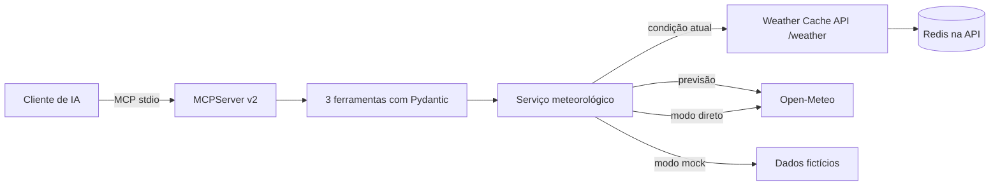

<div align="center">

# Weather MCP Server 🌦️

**Ferramentas meteorológicas para assistentes de IA, com MCP de verdade.**

[🇺🇸 English](README.md) · [🇧🇷 Português](README.pt-BR.md) · [🇪🇸 Español](README.es.md)

[](https://github.com/RamonRDR/weather-mcp-server/actions/workflows/ci.yml)
[](https://www.python.org/)
[](LICENSE)


[](https://github.com/RamonRDR/weather-cache-api)


</div>

> **Status do projeto:** Implementado no [PR #1](https://github.com/RamonRDR/weather-mcp-server/pull/1), aguardando revisão final do Codex e autorização de merge. O [último CI aprovado antes da manutenção](https://github.com/RamonRDR/weather-mcp-server/actions/runs/42416169603) confirmou **32 testes, 0 falhas e 0 ignorados**. Não declaramos deploy MCP remoto nem integração externa ponta a ponta validada ao vivo.

Servidor **Model Context Protocol (MCP)** somente leitura, com ferramentas estruturadas para condições atuais, previsão diária e comparação entre cidades. Utiliza o SDK oficial MCP Python e o transporte stdio, não uma API REST renomeada. As entradas e saídas são validadas por Pydantic.

## O que é MCP?

O MCP padroniza a descoberta e a execução de ferramentas pelos clientes de IA. O cliente inicia este servidor como processo local, negocia o protocolo, descobre as ferramentas e recebe dados estruturados. Não exige uma assinatura de IA ou um modelo real.

## Funcionalidades

| Ferramenta | Entrada | Saída |
| --- | --- | --- |
| `get_current_weather` | `city` (1–100 caracteres) | cidade, país, horário da observação, temperatura, sensação, umidade, precipitação, vento, condição e fonte |
| `get_weather_forecast` | `city`, `days` (1–7, padrão 3) | datas, mínimas, máximas, probabilidade de chuva, condições e fonte |
| `compare_weather` | `first_city`, `second_city` | duas leituras atuais e diferença de temperatura (primeira menos segunda) |

Dados opcionais ausentes aparecem como `null`, nunca inventados. Temperaturas em °C e vento em km/h. Não existem ferramentas de escrita, comandos de sistema, acesso a arquivos ou URLs arbitrárias.

## Stack tecnológica

**Execução:** Python **3.14** no GitHub Actions, SDK oficial MCP Python **>=2.3,<3** (stdio), Pydantic **v2** (`>=2.10,<3`), Pydantic Settings (`>=2.7,<3`) e httpx (`>=0.28,<1`). Badges com sinal de mais representam **versões mínimas declaradas**, não versões exatas fixadas.

**Integrações:** Três ferramentas MCP tipadas e somente leitura, com descoberta e respostas estruturadas. O adaptador da [Weather Cache API](https://github.com/RamonRDR/weather-cache-api) usa o contrato existente `GET /weather?city=` para condições atuais. Os endpoints fixos de geocodificação e previsão da Open-Meteo são usados para previsões diárias e, opcionalmente, para condições atuais diretamente. Os adaptadores estão **implementados e testados com HTTP simulado**; não declaramos uma execução real dos dois serviços juntos. O Redis pertence à outra API; **este repositório não tem banco de dados próprio nem Docker Compose**.

**Qualidade:** pytest (inclusive parametrização), pytest-asyncio, Ruff para lint e formatação, integração MCP por stdio, GitHub Actions, setuptools como backend de build e `python -m build` para gerar wheel e distribuição de código-fonte. O CI valida a instalação do wheel; não executa mypy, build Docker, OpenAPI/Swagger ou medição de cobertura.

## Estrutura do projeto

| Caminho | Responsabilidade |
| --- | --- |
| `src/weather_mcp_server/server.py` | Servidor MCP, três ferramentas tipadas e tratamento público de erros |
| `src/weather_mcp_server/__main__.py` | Inicialização local via stdio |
| `src/weather_mcp_server/service.py` | Adaptadores HTTP Weather Cache API e Open-Meteo |
| `src/weather_mcp_server/schemas.py` | Contratos Pydantic de entrada, saída e provedor |
| `src/weather_mcp_server/config.py` | Configuração e restrições de URLs externas |
| `src/weather_mcp_server/rate_limit.py` | Limite de chamadas por processo |
| `src/weather_mcp_server/demo.py`, `demo_data.py` | Demonstração offline com dados explicitamente fictícios |
| `tests/test_mcp.py`, `tests/test_service.py` | Testes do protocolo e HTTP simulado |
| `scripts/check_readme_badges.py` | Consistência dos badges com o relatório JUnit do pytest |
| `.github/workflows/ci.yml` | Ruff, testes, badges e validação de pacotes |

## Arquitetura



Integração com [Weather Cache API](https://github.com/RamonRDR/weather-cache-api): a implementação está na branch **main**; o contrato foi inspecionado, mas não há validação ao vivo da execução conjunta. Há `GET /weather?city=` para condições atuais e `GET /metrics`, mas **não há endpoint de previsão**. Este projeto preserva o cache na API original e consulta a Open-Meteo diretamente para a previsão.

## Instalação

Use Python **3.14** e um ambiente virtual:

```bash
python -m venv .venv
# Ative o ambiente de acordo com seu sistema operacional.
python -m pip install -e '.[dev]'
cp .env.example .env
```

No PowerShell: `Copy-Item .env.example .env` e `.venv\Scripts\Activate.ps1`.

## Configuração

| Variável | Padrão | Finalidade |
| --- | --- | --- |
| `MCP_BACKEND` | `cache_api` | `cache_api`, `open_meteo` ou `mock` |
| `MCP_CACHE_API_BASE_URL` | `http://127.0.0.1:8000` | origem da API existente; HTTPS obrigatório fora do loopback |
| `MCP_HTTP_TIMEOUT_SECONDS` | `5` | timeout HTTP em segundos, positivo até 30 |
| `MCP_RATE_LIMIT_CALLS` | `60` | número máximo de chamadas por processo |
| `MCP_RATE_LIMIT_WINDOW_SECONDS` | `60` | janela do limitador |
| `MCP_LOG_LEVEL` | `INFO` | logs JSON no stderr |

O modo padrão `cache_api` exige que a API original esteja rodando para consultas atuais. Se ela não estiver disponível, configure `MCP_BACKEND=open_meteo` para consulta direta e real, sem Redis. Com `MCP_BACKEND=mock`, todas as respostas usam **dados fictícios fixos**, úteis para testes.

## Execução do servidor

```bash
python -m weather_mcp_server
# ou:
weather-mcp-server
```

O processo fica aguardando o cliente MCP. Não digite prompts comuns no terminal do processo. stdout é exclusivo do protocolo, e logs vão para stderr.

### Configuração ilustrativa de cliente

O formato exato depende do aplicativo host:

```json
{
  "mcpServers": {
    "weather": {
      "command": "python",
      "args": ["-m", "weather_mcp_server"],
      "env": {"MCP_BACKEND": "mock"}
    }
  }
}
```

O Python escolhido deve ter este pacote instalado. Substitua o backend por `open_meteo` para dados reais ou `cache_api` para usar a API original em execução.

### MCP Inspector

Instale Node.js/`npx` e execute no ambiente Python:

```bash
MCP_BACKEND=mock npx @modelcontextprotocol/inspector python -m weather_mcp_server
```

PowerShell: `$env:MCP_BACKEND='mock'; npx @modelcontextprotocol/inspector python -m weather_mcp_server`. Descubra as três ferramentas, execute uma consulta, previsão, comparação e entrada inválida. Veja [instruções da demo](docs/demo.md).

## Exemplo de resposta

**Amostra fictícia**, não uma observação real:

```json
{
  "location": {"name": "Berlin", "country": "Germany", "latitude": 52.52, "longitude": 13.41},
  "observed_at": "2026-10-01T12:00:00Z",
  "temperature_c": 18.0,
  "apparent_temperature_c": null,
  "relative_humidity_percent": null,
  "precipitation_mm": null,
  "wind_speed_kmh": null,
  "weather_code": 0,
  "condition": "Clear sky (fictional sample)",
  "source": "mock-fixture",
  "cached": null
}
```

A previsão retorna dias e temperaturas estruturados, e a comparação traz ambas as leituras e a diferença. Entradas inválidas geram erro de ferramenta MCP (`is_error=true`), não sucesso enganoso.

## Testes e GitHub Actions

```bash
ruff check .
ruff format --check .
python -m pytest -q
python -m build
python -m weather_mcp_server.demo
```

O CI utiliza runner padrão do GitHub com Python 3.14 para Ruff, testes unitários com HTTP simulado, integração cliente-servidor MCP em memória e por stdio real, além do build. Não depende da API externa, Redis, credenciais ou chamadas pagas de IA. Não há deploy nem merge automático.

### Evidências e manutenção dos badges

O badge **pytest 32 passing** é uma fotografia estática da [execução Quality #6, commit `e2c6599`](https://github.com/RamonRDR/weather-mcp-server/actions/runs/42416169603), que registrou **32 aprovados**, sem falhas ou testes ignorados. O badge do workflow acompanha a **branch de desenvolvimento** até o merge em `main`; depois, seu parâmetro de branch deverá ser atualizado em uma alteração de documentação revisada.

O CI executa pytest gerando um relatório JUnit XML. Depois, `scripts/check_readme_badges.py` compara a contagem real de casos aprovados com o badge nos três READMEs e confere se seus conjuntos de badges são idênticos. Mudanças nos testes exigem atualização do contador estático nos **três arquivos**; não há commits automáticos nem tokens externos. O badge de workflow é dinâmico, mas o de pytest não.

O Python 3.14 foi confirmado no CI. MCP SDK `2.3+`, httpx `0.28+` e Pydantic Settings `2.7+` representam versões mínimas declaradas, não necessariamente as versões exatas instaladas. Os dois adaptadores meteorológicos têm testes com mocks, sem validação ao vivo dos serviços em conjunto.

## Segurança e limitações

Entradas têm limites de tamanho e de quantidade de dias. Destinos HTTP são fixos no código ou nas configurações controladas pelo operador, com HTTPS remoto obrigatório e redirecionamentos desabilitados. Timeouts e erros HTTP geram mensagens públicas sem segredos; logs ficam em stderr. Existe limitador por processo, **não** autenticação distribuída. Cidades ambíguas podem resolver para a primeira correspondência do provedor.

A integração utiliza o contrato da Weather Cache API já disponível na branch **main** do projeto original. Sua execução continua separada e a comunicação real entre os dois serviços ainda não foi validada ponta a ponta. Chamadas reais precisam de rede. O transporte HTTP remoto não foi implementado devido à necessidade de autenticação, proteção de origem e sessões. Consulte [decisões](docs/architecture.md) e [demonstração](docs/demo.md).

## Contribuições

Issues e pull requests são bem-vindos. Execute `ruff check .`, `ruff format --check .` e `python -m pytest -q` antes de propor alterações. Preserve as ferramentas como somente leitura, não aceite URLs arbitrárias e nunca publique credenciais. Merges exigem autorização do mantenedor.

## Licença

Dados meteorológicos por [Open-Meteo](https://open-meteo.com/); verifique os termos de atribuição e uso comercial. Código sob [licença MIT](LICENSE). © 2026 Ramon Rodriguez.
