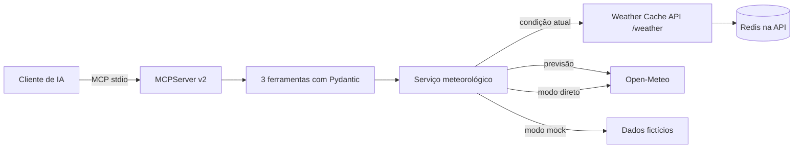

# Weather MCP Server

[](https://github.com/RamonRDR/weather-mcp-server/actions/workflows/ci.yml)

**Python 3.14 · SDK oficial MCP v2 · Pydantic v2 · httpx · Open-Meteo**

Servidor verdadeiro de **Model Context Protocol (MCP)**, com três ferramentas de leitura para assistentes de IA. Utiliza o transporte stdio, publica schemas tipados de entrada e saída e responde a chamadas MCP, sem simular o protocolo através de uma API REST.

[English](README.md) · [Español](README.es.md) · [Arquitetura](docs/architecture.md) · [Demonstração](docs/demo.md)

## O que é MCP?

O MCP padroniza a descoberta e a execução de ferramentas pelos clientes de IA. O cliente inicia este servidor como processo local, negocia o protocolo, descobre as ferramentas e recebe dados estruturados. Não exige uma assinatura de IA ou um modelo real.

## Ferramentas

| Ferramenta | Entrada | Saída |
| --- | --- | --- |
| `get_current_weather` | `city` (1–100 caracteres) | cidade, país, horário da observação, temperatura, sensação, umidade, precipitação, vento, condição e fonte |
| `get_weather_forecast` | `city`, `days` (1–7, padrão 3) | datas, mínimas, máximas, probabilidade de chuva, condições e fonte |
| `compare_weather` | `first_city`, `second_city` | duas leituras atuais e diferença de temperatura (primeira menos segunda) |

Dados opcionais ausentes aparecem como `null`, nunca inventados. Temperaturas em °C e vento em km/h. Não existem ferramentas de escrita, comandos de sistema, acesso a arquivos ou URLs arbitrárias.

## Arquitetura



Integração com [Weather Cache API](https://github.com/RamonRDR/weather-cache-api): a implementação está na branch `feat/cycle-1-weather-cache`, ainda sem merge na main. Há `GET /weather?city=` para condições atuais e `GET /metrics`, mas **não há endpoint de previsão**. Este projeto preserva o cache na API original e consulta a Open-Meteo diretamente para a previsão.

## Instalação

Use Python **3.14** e um ambiente virtual:

```bash
python -m venv .venv
# Ative o ambiente de acordo com seu sistema operacional.
python -m pip install -e '.[dev]'
cp .env.example .env
```

No PowerShell: `Copy-Item .env.example .env` e `.venv\Scripts\Activate.ps1`.

## Configuração

| Variável | Padrão | Finalidade |
| --- | --- | --- |
| `MCP_BACKEND` | `cache_api` | `cache_api`, `open_meteo` ou `mock` |
| `MCP_CACHE_API_BASE_URL` | `http://127.0.0.1:8000` | origem da API existente; HTTPS obrigatório fora do loopback |
| `MCP_HTTP_TIMEOUT_SECONDS` | `5` | timeout HTTP em segundos, positivo até 30 |
| `MCP_RATE_LIMIT_CALLS` | `60` | número máximo de chamadas por processo |
| `MCP_RATE_LIMIT_WINDOW_SECONDS` | `60` | janela do limitador |
| `MCP_LOG_LEVEL` | `INFO` | logs JSON no stderr |

O modo padrão `cache_api` exige que a API original esteja rodando para consultas atuais. Se ela não estiver disponível, configure `MCP_BACKEND=open_meteo` para consulta direta e real, sem Redis. Com `MCP_BACKEND=mock`, todas as respostas usam **dados fictícios fixos**, úteis para testes.

## Execução do servidor

```bash
python -m weather_mcp_server
# ou:
weather-mcp-server
```

O processo fica aguardando o cliente MCP. Não digite prompts comuns no terminal do processo. stdout é exclusivo do protocolo, e logs vão para stderr.

### Configuração ilustrativa de cliente

O formato exato depende do aplicativo host:

```json
{
  "mcpServers": {
    "weather": {
      "command": "python",
      "args": ["-m", "weather_mcp_server"],
      "env": {"MCP_BACKEND": "mock"}
    }
  }
}
```

O Python escolhido deve ter este pacote instalado. Substitua o backend por `open_meteo` para dados reais ou `cache_api` para usar a API original em execução.

### MCP Inspector

Instale Node.js/`npx` e execute no ambiente Python:

```bash
MCP_BACKEND=mock npx @modelcontextprotocol/inspector python -m weather_mcp_server
```

PowerShell: `$env:MCP_BACKEND='mock'; npx @modelcontextprotocol/inspector python -m weather_mcp_server`. Descubra as três ferramentas, execute uma consulta, previsão, comparação e entrada inválida. Veja [instruções da demo](docs/demo.md).

## Exemplo de resposta

**Amostra fictícia**, não uma observação real:

```json
{
  "location": {"name": "Berlin", "country": "Germany", "latitude": 52.52, "longitude": 13.41},
  "observed_at": "2026-10-01T12:00:00Z",
  "temperature_c": 18.0,
  "apparent_temperature_c": null,
  "relative_humidity_percent": null,
  "precipitation_mm": null,
  "wind_speed_kmh": null,
  "weather_code": 0,
  "condition": "Clear sky (fictional sample)",
  "source": "mock-fixture",
  "cached": null
}
```

A previsão retorna dias e temperaturas estruturados, e a comparação traz ambas as leituras e a diferença. Entradas inválidas geram erro de ferramenta MCP (`is_error=true`), não sucesso enganoso.

## Testes e GitHub Actions

```bash
ruff check .
ruff format --check .
python -m pytest -q
python -m build
python -m weather_mcp_server.demo
```

O CI utiliza runner padrão do GitHub com Python 3.14 para Ruff, testes unitários com HTTP simulado, integração cliente-servidor MCP em memória e por stdio real, além do build. Não depende da API externa, Redis, credenciais ou chamadas pagas de IA. Não há deploy nem merge automático.

## Segurança e limitações

Entradas têm limites de tamanho e de quantidade de dias. Destinos HTTP são fixos no código ou nas configurações controladas pelo operador, com HTTPS remoto obrigatório e redirecionamentos desabilitados. Timeouts e erros HTTP geram mensagens públicas sem segredos; logs ficam em stderr. Existe limitador por processo, **não** autenticação distribuída. Cidades ambíguas podem resolver para a primeira correspondência do provedor.

A integração depende da branch ainda não incorporada da Weather Cache API, cuja execução é separada. Chamadas reais precisam de rede. O transporte HTTP remoto não foi implementado devido à necessidade de autenticação, proteção de origem e sessões. Consulte [decisões](docs/architecture.md) e [demonstração](docs/demo.md).

## Licença

Dados meteorológicos por [Open-Meteo](https://open-meteo.com/); verifique os termos de atribuição e uso comercial. Código sob [licença MIT](LICENSE). © 2026 Ramon Rodriguez.
